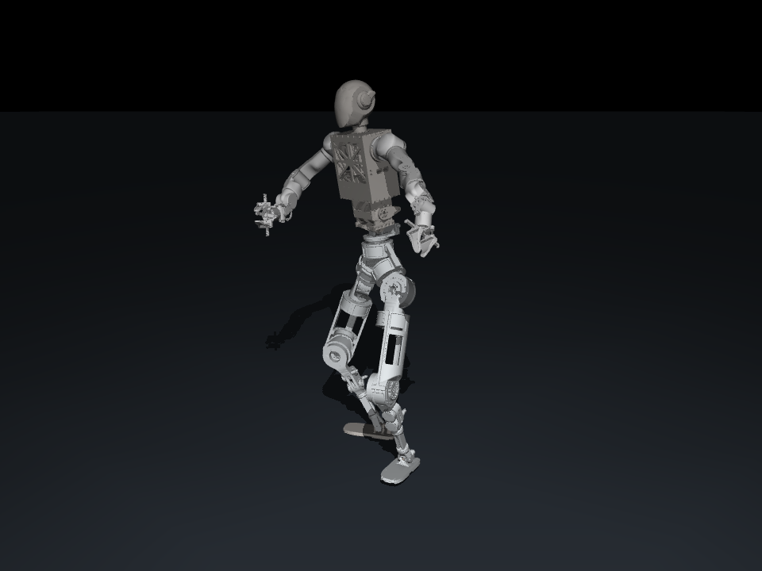

# A00 / JLJ 机器人 GMR 动作重定向

已针对本文件夹的 **A00 29 自由度机器人**建立独立的重定向工程，参考本地 `/home/rx/project/GMR` 的两阶段 GMR 方法。运行时不依赖原 GMR 文件夹，也不会覆盖原 XML 或其他 GMR 项目。

支持：Nokov BVH、LAFAN1 BVH、SMPL-X NPZ、通用人体世界坐标姿态 NPZ；输出 GMR PKL、NPZ 或 CSV；提供交互回放和离线 PNG/MP4 渲染。



[观看 10 秒动作演示](examples/demo.mp4)

仓库包含代码、机器人 XML/STL 和演示文件。`outputs/` 为本地生成目录，不随 Git 提交；下文列出的完整动作与诊断文件可通过转换命令重新生成。

## 直接使用本机已有环境

已在 `/home/rx/miniconda3/envs/gmr` 中安装本工程的可编辑包。当前文件夹直接执行：

```bash
# 查看模型、关节顺序、关节限位
./run.sh inspect

# 将本地已有 Nokov 动作重定向到 A00，输出 30 fps
./run.sh retarget \
  --input /home/rx/project/GMR/input/right31-right.bvh \
  --format nokov --fps 30 --max-joint-speed 6 \
  --output outputs/my_motion.pkl

# 打开机器人动作回放窗口
./run.sh view --motion outputs/my_motion.pkl --loop

# 无需窗口，导出视频
./run.sh render --motion outputs/my_motion.pkl --output outputs/my_motion.mp4
```

`run.sh` 自动使用本机已有的 `gmr` Python；也可通过 `JLJ_GMR_PYTHON=/你的环境/bin/python` 指定解释器。已激活环境时可使用 `python -m jlj_gmr ...` 或 `jlj-gmr ...`。

迁移至其他电脑时，保留整个文件夹（包括 XML 和 meshes），然后运行 `python -m pip install -e '.[render]'`。SMPL-X 输入另外安装 `.[smplx]`。目前以源码/可编辑安装形式使用，机器人资源位于工程目录，未打入 wheel。

## 已生成的实际样例

- `outputs/right31_a00.npz`：完整 Nokov 样例，原始 5,093 帧，约 56.6 秒，重采样到 30 fps。
- `outputs/right31_a00.pkl` / `.csv`：同一段 A00 动作的其他格式。
- `outputs/demo.mp4`：上述样例前 10 秒的演示视频。
- `outputs/preview.png`：动作中的一个静态预览。
- `outputs/right31_a00.npz.json`：输入、XML、配置快照、关节名、单位和处理统计。
- `outputs/right31_a00.npz.report.json`：每帧追踪误差、地面修正量等详细诊断。
- `outputs/validation.json`：对完整输出重新执行正运动学后得到的限位、脚底、四元数和速度检查结果。

输出均为**运动学动作轨迹**。当前样例存在肩、肘、踝限位饱和，人体动作不能完全复现；尚未做动力学平衡、全身自碰撞或真机控制验证。

## 这次做了哪些机器人适配

模型：`A00_MuJoCo_XML/A00_MuJoCo_XML/A00_robot_mujoco.xml`。MuJoCo 加载结果是 `nq=36, nv=35, nu=29`，包括浮动根节点和 29 个转动关节。

1. **A00 连杆映射与旋转补偿**：根节点 `base_link`、躯干 `waist_pitch`、腿部 `hip_yaw / knee / ankle_roll`、上肢 `shoulder_yaw / elbow / wrist_pitch`。通过参考模型 FK 和肢段方向，将 GMR 的人体旋转约定转换到 A00 的 CAD 连杆坐标系，左右腿分别计算。腕部目标作用于末端 `wrist_pitch`，能覆盖全部七个手臂关节。
2. **按实际长度适配人体比例**：固定骨盆到髋部、胸部到肩部的机器人结构，使用人体肢段方向和 A00 实际肢段长度构造膝、足、肘、腕位置。避免把整只手臂围绕人体骨盆统一缩放。可在配置中将 `morphology_scaling` 设为 `false`，使用 GMR 原本的根节点相对缩放方式。
3. **两阶段 IK**：第一阶段建立身体姿态和双足位置；第二阶段加入膝、肘、手腕位置细化。两阶段是先后优化，并不是严格任务优先级。使用 Mink + QP，显式传入 XML 关节限位，以前一帧作初值和轻量姿态正则。
4. **脚底地面处理**：使用 XML 的十个脚底胶囊碰撞体计算最低点，不把脚踝原点当作地面。目标足部姿态决定支撑高度；输出按需要抬高根节点，消除脚底穿地。
5. **输入和保存细节**：读取 BVH 自带的帧率和各关节真实通道顺序；人体数据不会被原地修改；两个 IK 阶段各自使用自己的位置/旋转偏移；保存包含最后一帧；人体身高越高，对固定机器人采用越小的根节点缩放。

原 XML 中髋 pitch 关节的零位世界轴带有约 45° 倾斜，本工程按 XML 原样求解；没有擅自改成标准 G1 的关节轴、左右对称性或关节范围。

## 输入格式

### Nokov / LAFAN1 BVH

```bash
./run.sh retarget --input /path/motion.bvh --format nokov \
  --fps 30 --max-joint-speed 6 --output outputs/motion.pkl

./run.sh retarget --input /path/dance.bvh --format lafan1 \
  --fps 30 --max-joint-speed 6 --output outputs/dance.npz
```

默认 BVH 是 **厘米、Y 轴朝上**，按本地 GMR 的约定转换为米、Z 轴朝上。根节点位置通道按 GMR/Nokov 约定覆盖根 OFFSET；子节点的位置通道加到 OFFSET 上。其他单位通过 `--unit-scale` 修改（例如原数据单位是米时设 `--unit-scale 1`）。

需要 `Hips, Spine2, Left/RightUpLeg, Left/RightLeg, Left/RightFoot, Left/RightArm, Left/RightForeArm, Left/RightHand`。Nokov 使用 `Left/RightToeBase`，LAFAN1 使用 `Left/RightToe`。足部位置取 Foot，方向取 Toe/ToeBase，与 GMR 一致。自动移除 `Mixamo:` 等关节名前缀；不同骨架命名需调整 JSON 配置或输入。

### SMPL-X

```bash
./run.sh retarget \
  --format smplx --input /path/motion.npz \
  --body-model /home/rx/project/GMR/assets/body_models \
  --fps 30 --output outputs/smplx_motion.pkl
```

支持本地 GMR 使用的 SMPL-X 参数格式：`pose_body (T,63)`、`root_orient (T,3)`、`trans (T,3)`、`betas (B,) / (1,B) / (T,B)`、字符串 `gender`，以及 `mocap_frame_rate / mocap_framerate / fps`。世界姿态和位移应与 GMR 的 Z-up 输入一致。原始 AMASS 的 `poses` / `trans` 格式或 GVHMR 的 `.pt` 文件需要先转换为上述格式；不把不同文件内容仅凭扩展名混用。

SMPL-X 模型文件沿用本机已有资源，不复制到工程中。已使用已有 neutral 模型验证了两帧参数到人体 FK 再到机器人 IK 的完整路径；尚未验证长段真实 SMPL-X 动作。

### 通用人体世界姿态 / 实时输入

NPZ 包含：`body_names (J,)` 字符串、`positions (T,J,3)` 米、`quaternions (T,J,4)` **wxyz**、标量 `fps`，可选标量 `human_height` 米。

```bash
./run.sh retarget --format poses --source bvh_nokov \
  --input /path/human_world_poses.npz --output outputs/motion.pkl
```

人体节点名、世界坐标轴和朝向约定需要匹配 `--source` 对应配置。也可逐帧调用：

```python
from jlj_gmr import A00Retargeter

retargeter = A00Retargeter(
    src_human="bvh_nokov", fps=60,
    actual_human_height=1.75,
    max_joint_speed=6.0,
)
# frame = {"Hips": (xyz_m, quat_wxyz), "Spine2": (...), ...}
qpos = retargeter.retarget(frame)  # (36,): xyz + wxyz + XML 顺序的 29 个关节角
print(retargeter.last_diagnostics)
```

一条连续动作复用同一个对象；新动作调用 `reset()`。`max_joint_speed` 限制连续输出帧间的关节角速度（rad/s），首帧自由求解以初始化动作。这个约束不限制浮动根节点，也不限制速度变化率。CLI 不指定时不加速度上限；建议先用示例中的 `6` 检查效果。

## 地面、身高和追踪参数

- `--ground-mode initial`（默认）：根据第一帧足部位置设置一次地面偏移，保留后续抬脚、跳跃的垂直变化；必要时对输出抬根，消除穿地。第一帧应包含可信的地面参考，如果从腾空开始，应自定义地面或选 `none`。
- `--ground-mode floor`：每帧把较低的脚对齐地面，会消除双脚同时腾空的高度。
- `--ground-mode none`：不做目标或输出地面修正，保留绝对坐标。
- `--human-height 1.75`：可选，单位米。未指定时使用配置中的 1.8 m 假设，不凭一个动作姿势猜身高。启用肢段长度适配后，身高只影响根节点缩放，肢段长度直接取机器人模型。
- `--fps 30`：对选定帧区间重采样，位置线性插值，旋转 SLERP；未指定则保留原始帧率。不会用改写输出 fps 的方式加速/减速动作。
- `--start-frame 900 --max-frames 450`：按**原始输入帧号**截取，再做重采样。
- `--max-iter 12`：每阶段的最大迭代次数。默认求解器 `proxqp`，也可 `--solver daqp`（本机已有）。

三个源格式分别对应 `jlj_gmr/configs/bvh_nokov_to_a00.json`、`bvh_lafan1_to_a00.json`、`smplx_to_a00.json`。条目格式沿用 GMR：

```text
机器人连杆名: [人体节点名, 位置代价, 旋转代价, 局部位置偏移xyz, 旋转偏移wxyz]
```

这些是经过当前模型和样例验证的初始标定，不代表所有动作的最优配置。`--config /path/custom.json` 可以覆盖。若希望严格复用原始缩放与位置偏移，关闭 `morphology_scaling`；启用时会重建四肢位置目标。每次输出都会保存实际使用的配置快照，便于复现。

## 输出约定

| 文件 | 位置与旋转 | 关节顺序 |
| --- | --- | --- |
| GMR `.pkl` | `root_pos` 为米；`root_rot` 为 **xyzw**；`dof_pos` 为弧度；包含 `fps` | A00 XML 的 29 关节顺序，附带 `joint_names` |
| `.npz` | `qpos` 为 `[xyz, wxyz, joints]`；另含 GMR 形式的 `root_pos/root_rot/dof_pos` | 同上 |
| `.csv` | 带列名，36 列 `[xyz, wxyz, joints]`，无时间列 | 同上，表头明确命名；帧率在同名 `.csv.json` |

固定顺序：**右腿 6 → 左腿 6 → 腰 3 → 左臂 7 → 右臂 7**。完整名称见 `jlj_gmr/configs/joint_order.json`。不能直接按 Unitree G1 的关节序号消费这些数据。PKL 读取用于本工程生成的可信本地动作文件。

## 检查与复现

```bash
/home/rx/miniconda3/envs/gmr/bin/python -m unittest discover -s tests -v
# 对输出动作重新执行 FK，检查实际限位、脚底与速度：
/home/rx/miniconda3/envs/gmr/bin/python tools/validate_motion.py \
  outputs/right31_a00.npz --max-joint-speed 6 --output outputs/validation.json
# 模型或 GMR 参考配置更新后，重新生成 A00 坐标补偿：
/home/rx/miniconda3/envs/gmr/bin/python tools/build_configs.py --gmr /home/rx/project/GMR
```

测试覆盖三种源格式的已知参考姿态、输入不变性、地面与身高、连续输出速度与关节限位、两阶段独立偏移、导出最后一帧与四元数顺序、位置/旋转重采样、BVH 不同关节通道顺序。LAFAN1 的坐标和参考姿态已测试，尚未使用真实 LAFAN1 长动作做验证。

本机验证环境：Python 3.10、MuJoCo 3.3.7、Mink 0.0.13、qpsolvers 4.8.1、NumPy 2.2.6、SciPy 1.15.3。

## 来源

算法流程、JSON 配置格式、人体骨架约定参考本地 GMR；派生配置和 SMPL-X FK 保留其 MIT 授权，见 `LICENSE-GMR`。机器人 XML 和 STL 为用户提供的资产。`GMR_self` 主要增加 VMC 输入，本工程目前实现的是独立逐帧接口和离线流程，未接入该项目的 VMC 网络接收或真机控制程序。
